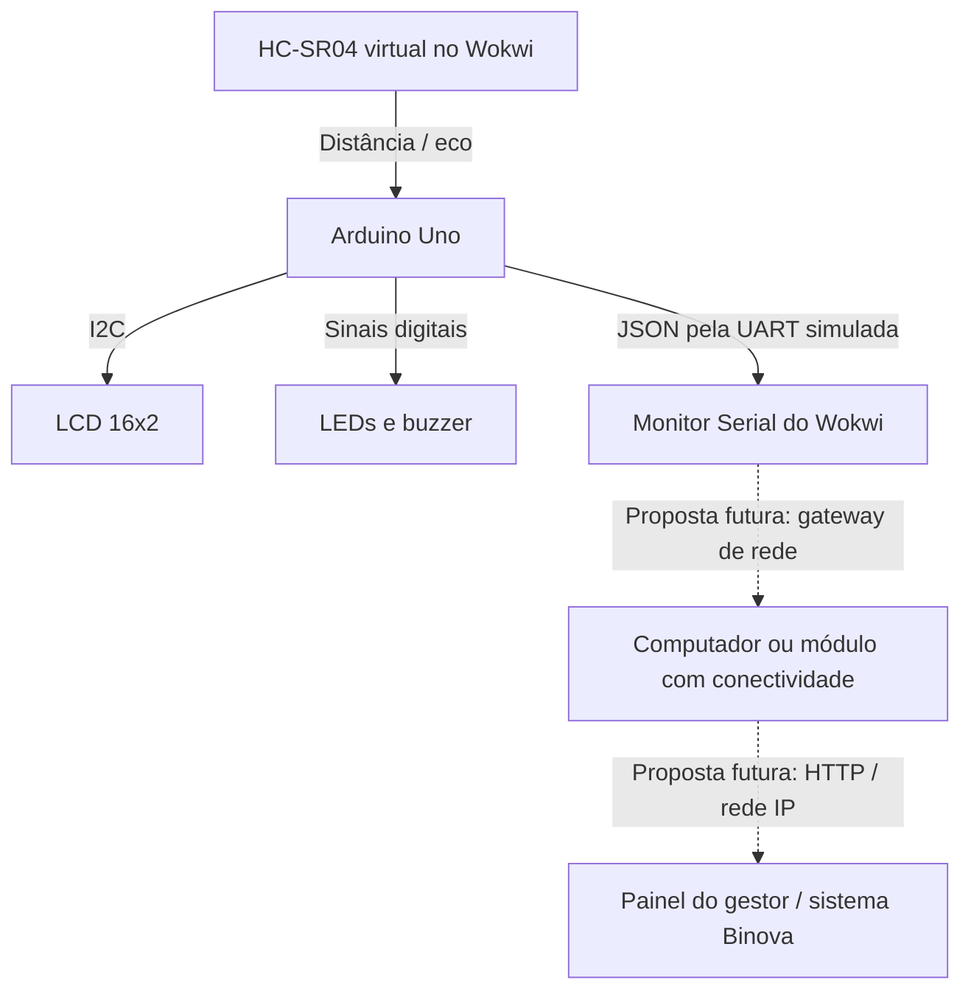

# Proposta de arquitetura e comunicação — Binova

**Este é um diagrama de arquitetura proposto, não uma evidência de conexão de rede implementada.**

## Situação real x proposta

- **Implementado no Wokwi:** simulação do HC-SR04, processamento no Arduino, LCD, LEDs, buzzer e impressão de JSON no Monitor Serial.
- **Proposto para evolução:** transmissão pela rede, mediante dispositivo ou módulo com conectividade, para apresentação dos dados a um gestor.
- **Não implementado nesta entrega:** FastAPI, integração Java, Wi-Fi no Arduino Uno, gateway e comunicação HTTP real.

A disciplina solicita a identificação de dispositivos, meios de comunicação e caminho dos dados. A infraestrutura proposta pode ser explicada sem afirmar que houve uma integração de rede funcional.
