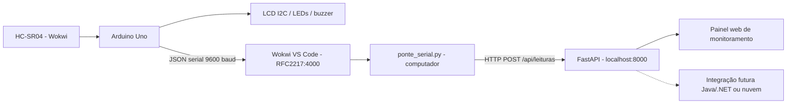

# Arquitetura de comunicação — Binova

O circuito Arduino Uno é simulado no Wokwi. Para demonstrar a conectividade com uma aplicação, foi adicionada uma ponte local **Serial RFC2217 → Python → HTTP POST → FastAPI**.

**Implementado em código:** saída serial do Arduino, ponte Python, validação e histórico HTTP em FastAPI, painel web.  
**Ainda precisa ser comprovado:** execução da comunicação ponta a ponta no computador do grupo, com Wokwi VS Code aberto, ponte ativa e leituras recebidas.  
**Não implementado:** conectividade Wi-Fi no Arduino Uno, integração automática com APIs Java/.NET e envio para serviço de nuvem.

O Wokwi no navegador serve para testar o circuito, mas a porta RFC2217 desta implementação é fornecida pela extensão de VS Code. O computador é o componente que possui acesso à rede e envia HTTP.
