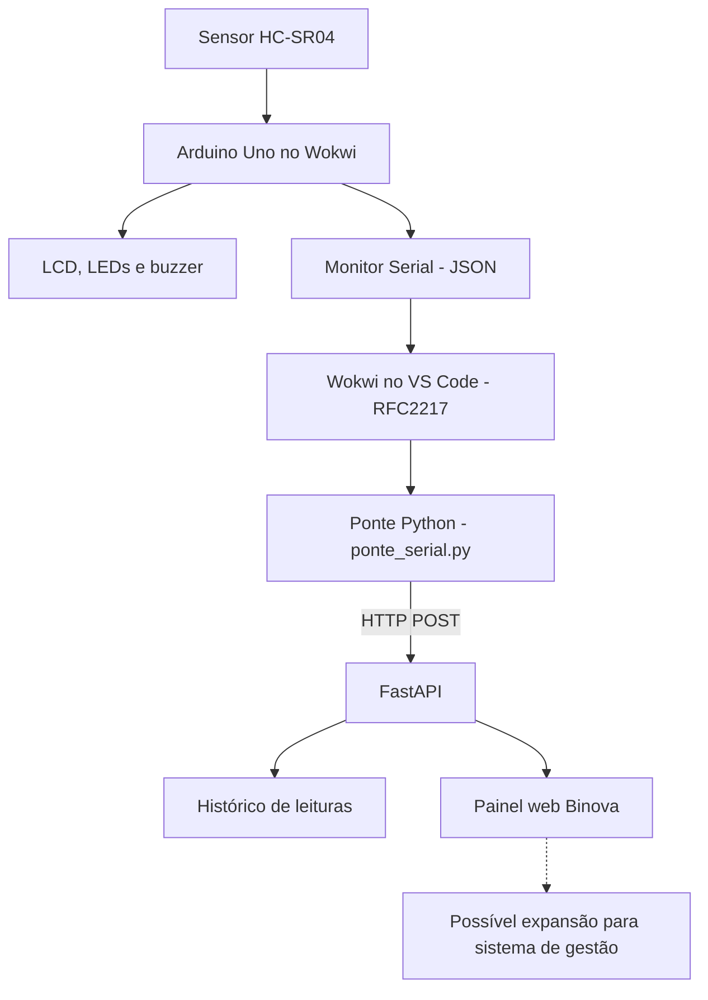

# Binova - IoT ♻️

**FIAP | Global Solution 2026/2 - CitizenTech**  
**Disciplina:** Disruptive Architectures: IoT, IoB & Generative IA  
**Curso:** Análise e Desenvolvimento de Sistemas  
**Turma:** 2TDSPS  
**Repositório:** https://github.com/GustavoSiciliano/GlobalSolution_2026_IoT  
**Projeto Wokwi:** https://wokwi.com/projects/480777708369869825

> **Para o professor:** o projeto possui duas formas de avaliação: a simulação do circuito Arduino diretamente no Wokwi e a demonstração de comunicação com FastAPI pelo VS Code. Para verificar a integração, siga a seção **7. Como executar a integração completa**, altere a distância do sensor e acompanhe a mesma leitura no Monitor Serial, no terminal da ponte Python e no painel web.

---

## 1. Apresentação do projeto

O **Binova** é uma solução desenvolvida para a Global Solution 2026/2 da FIAP, dentro do tema **CitizenTech**. Seu objetivo é contribuir para o monitoramento de lixeiras e pontos de coleta de resíduos, permitindo identificar situações em que uma lixeira está próxima de atingir sua capacidade máxima.

O problema abordado pelo projeto é a dificuldade de acompanhar o nível de preenchimento das lixeiras de forma contínua. Sem informações atualizadas, os responsáveis pela coleta podem encontrar recipientes transbordando ou realizar recolhimentos desnecessários.

Nossa proposta utiliza um **Arduino Uno** e um sensor ultrassônico **HC-SR04** para estimar o preenchimento de uma lixeira. As informações são apresentadas em um display LCD, com sinalização por LEDs e alertas sonoros.

Para relacionar o protótipo aos conceitos de Redes de Computadores, também desenvolvemos uma integração local utilizando **Python e FastAPI**. Nessa etapa, os dados produzidos pelo Arduino simulado são transmitidos pela comunicação serial e encaminhados a uma API HTTP, que disponibiliza as informações em um painel web.

O projeto foi construído e organizado para facilitar a execução, os testes e a apresentação do seu funcionamento.

## 2. Integrantes

| Integrante | RM |
|---|---|
| Gustavo de Jesus | 567926 |
| Gustavo Siciliano | 568419 |
| Samuel Keniti | 567614 |
| Manuel Pedro | 567458 |
| Vinicius Morrone | 566884 |

**Instituição:** FIAP  
**Curso:** Análise e Desenvolvimento de Sistemas  
**Turma:** 2TDSPS

## 3. Tecnologias utilizadas

O projeto utiliza as seguintes tecnologias e componentes:

| Tecnologia ou componente | Finalidade |
|---|---|
| Arduino Uno | Processar as leituras e controlar os componentes |
| HC-SR04 | Medir a distância entre o sensor e os resíduos |
| LCD 16×2 I2C | Exibir o percentual de preenchimento |
| LED verde | Indicar que a lixeira está disponível |
| LED amarelo | Indicar o estado de atenção |
| LED vermelho | Indicar proximidade do limite ou lixeira cheia |
| Buzzer | Emitir alertas sonoros em níveis críticos |
| Protoboard e resistores de 220 Ω | Organizar e proteger as conexões dos LEDs |
| Arduino/C++ | Implementar a lógica de monitoramento |
| Wokwi | Simular os componentes eletrônicos |
| PlatformIO | Compilar o projeto Arduino no VS Code |
| Python | Interpretar e encaminhar as leituras recebidas |
| PySerial | Acessar a comunicação serial virtual |
| Requests | Enviar requisições HTTP à API |
| FastAPI | Receber, validar e consultar as leituras |
| Pydantic | Validar os dados recebidos |
| HTML, CSS e JavaScript | Construir o painel web |
| Git e GitHub | Versionar e disponibilizar os arquivos |

A escolha do **HC-SR04** foi motivada pela possibilidade de estimar o volume ocupado sem contato direto com os resíduos.

O **Arduino Uno** foi escolhido por permitir trabalhar de forma simples com sensores, entradas, saídas e processamento de informações.

A **FastAPI** foi utilizada para demonstrar como os dados produzidos por um dispositivo IoT podem ser recebidos e consultados por uma aplicação.

## 4. Funcionamento do protótipo

### 4.1 Leitura do sensor

O sensor HC-SR04 utiliza ondas ultrassônicas para medir a distância até um objeto.

No Binova, essa distância representa o espaço disponível entre o sensor e a superfície dos resíduos.

Para a simulação, definimos duas referências:

| Referência | Distância | Preenchimento |
|---|---|---|
| Lixeira vazia | 25 cm | 0% |
| Lixeira cheia | 5 cm | 100% |

O cálculo realizado pelo Arduino é:

```text
Preenchimento (%) =
100 × (Distância vazia - Distância medida)
    / (Distância vazia - Distância cheia)
```

O resultado é limitado ao intervalo de 0% a 100%.

Por exemplo, uma leitura de 15 cm corresponde a aproximadamente 50% de preenchimento.

Para reduzir oscilações, o programa utiliza a **mediana de cinco medições válidas** e atualiza as informações aproximadamente a cada dois segundos.

### 4.2 Classificação dos níveis

Os percentuais foram divididos em quatro faixas:

| Preenchimento | Situação | LED | Buzzer |
|---|---|---|---|
| 0% a 49% | DISPONIVEL | Verde | Sem alerta |
| 50% a 74% | ATENCAO | Amarelo | Sem alerta |
| 75% a 94% | PROX. DO LIMITE | Vermelho | Alerta ao entrar na faixa |
| 95% a 100% | CHEIO | Vermelho | Alerta ao entrar na faixa |

O display LCD apresenta o percentual calculado e o estado correspondente.

Os LEDs indicam visualmente a situação da lixeira. O buzzer emite um aviso quando o preenchimento entra em uma das faixas críticas.

### 4.3 Mapeamento dos pinos

| Componente | Pino Arduino |
|---|---|
| HC-SR04 - TRIG | D8 |
| HC-SR04 - ECHO | D2 |
| LED verde | A0 |
| LED amarelo | A1 |
| LED vermelho | A2 |
| Buzzer | A3 |
| LCD - SDA | A4 |
| LCD - SCL | A5 |

Os componentes recebem alimentação pelas conexões de 5 V e GND do circuito, conforme o arquivo `diagram.json`.

### 4.4 Modos de funcionamento

O Arduino possui dois modos para facilitar os testes.

**Modo sensor**

É o funcionamento principal do sistema. O Arduino lê o HC-SR04 e calcula o preenchimento automaticamente.

No arquivo `GlobalSolution_Sensor_Lixo/sketch.ino`, utilize:

```cpp
const int NIVEL_MANUAL = -1;
```

**Modo manual**

Foi implementado para permitir a demonstração de percentuais exatos, independentemente da distância medida.

Por exemplo:

```cpp
const int NIVEL_MANUAL = 83;
```

Nesse caso, o LCD apresentará 83%, o LED vermelho será acionado e o sistema aplicará a classificação correspondente.

O modo manual aceita valores inteiros de **1 a 100**.

**Importante:** os valores definidos manualmente são utilizados para testar LCD, LEDs e alertas. Eles não representam medições realizadas pelo sensor.

## 5. Estrutura do repositório

O projeto foi organizado para separar o circuito original, a integração com FastAPI e as evidências.

```text
GlobalSolution_2026_IoT/
│
├── README.md
├── .gitignore
│
├── GlobalSolution_Sensor_Lixo/
│   ├── sketch.ino
│   ├── diagram.json
│   ├── libraries.txt
│   └── wokwi-project.txt
│
├── Integracao_FastAPI/
│   ├── app.py
│   ├── ponte_serial.py
│   ├── requirements.txt
│   ├── testar_http.py
│   ├── platformio.ini
│   ├── wokwi.toml
│   ├── diagram.json
│   ├── README.md
│   │
│   ├── src/
│   │   └── main.cpp
│   │
│   ├── static/
│   │   └── index.html
│   │
│   ├── tests/
│   │   └── test_api.py
│   │
│   └── dados/
│       └── .gitkeep
│
└── Evidencias/
    ├── 01_Circuito/
    ├── 02_Leitura_HC_SR04/
    ├── 03_Testes_Manuais/
    ├── 04_Monitor_Serial/
    ├── 05_Componentes/
    ├── 06_Video/
    └── 07_Arquitetura_Proposta/
```

### Responsabilidade das pastas

| Pasta | Responsabilidade |
|---|---|
| `GlobalSolution_Sensor_Lixo` | Circuito original do Arduino e arquivos do Wokwi |
| `Integracao_FastAPI` | API, painel, comunicação serial, testes e configuração do VS Code |
| `Evidencias` | Capturas dos componentes, testes e documentação de demonstração |

A pasta `GlobalSolution_Sensor_Lixo` possui **somente os quatro arquivos originais**.

Os arquivos adicionais utilizados para executar o Wokwi no VS Code permanecem dentro de `Integracao_FastAPI`.

O arquivo `src/main.cpp` inclui o `sketch.ino` original, evitando a manutenção de duas versões da lógica Arduino.

O `diagram.json` dentro de `Integracao_FastAPI` é uma cópia utilizada pela extensão Wokwi. Caso o circuito original seja alterado, essa cópia também deverá ser atualizada.

## 6. Arquitetura e comunicação em rede

A arquitetura do Binova foi dividida em aquisição de dados, processamento, comunicação e visualização.



### 6.1 Como os dados percorrem o sistema

**1. Aquisição**

O sensor HC-SR04 mede a distância até os resíduos simulados.

**2. Processamento**

O Arduino converte a distância em percentual, classifica o estado da lixeira e atualiza os componentes.

**3. Comunicação serial**

O Arduino envia os dados no formato JSON, utilizando comunicação serial a 9600 baud.

**4. Ponte de comunicação**

No Wokwi para VS Code, a comunicação serial é disponibilizada por um servidor virtual RFC2217, configurado na porta `4000`.

O arquivo `ponte_serial.py` recebe as mensagens e verifica se estão no formato esperado.

**5. Comunicação HTTP**

Após interpretar a leitura, a ponte Python envia uma requisição `POST` para a FastAPI.

**6. Recebimento e visualização**

A FastAPI valida a informação, registra o resultado e disponibiliza os dados para o painel web.

### 6.2 Por que utilizamos uma ponte Python?

O Arduino Uno não possui conexão Wi-Fi nativa.

Por esse motivo, o Arduino não realiza diretamente uma requisição HTTP.

A comunicação funciona da seguinte forma:

```text
Arduino Uno
    ↓
Serial virtual do Wokwi
    ↓
Computador com Python
    ↓
Requisição HTTP
    ↓
FastAPI
    ↓
Painel web
```

Na demonstração, a FastAPI utiliza `127.0.0.1:8000`, ou seja, a comunicação HTTP ocorre localmente no computador, pelo endereço de loopback.

A arquitetura poderia ser adaptada futuramente para enviar dados a outro computador, servidor ou serviço em nuvem, mas isso não faz parte da implementação atual.

## 7. Como executar a integração completa

Esta seção apresenta o procedimento para executar o Arduino no Wokwi e transmitir suas leituras para a FastAPI.

### 7.1 Pré-requisitos

Para executar a integração, é necessário:

- Python 3.10 ou superior.
- Visual Studio Code.
- Extensão PlatformIO IDE.
- Extensão Wokwi para VS Code.
- Acesso ao projeto e suas dependências.
- Configuração da extensão Wokwi para executar a simulação.

O procedimento abaixo utiliza o terminal PowerShell do Windows.

### 7.2 Abrir o projeto

Clone o repositório:

```powershell
git clone https://github.com/GustavoSiciliano/GlobalSolution_2026_IoT.git
```

Acesse a pasta:

```powershell
cd GlobalSolution_2026_IoT
```

Se preferir, baixe o ZIP do GitHub, extraia o conteúdo e abra a pasta do projeto no VS Code.

### 7.3 Instalar as dependências da FastAPI

Abra um terminal na raiz do repositório e execute:

```powershell
cd .\Integracao_FastAPI
```

Instale as bibliotecas Python:

```powershell
py -m pip install -r requirements.txt
```

As dependências incluem FastAPI, Uvicorn, Pydantic, PySerial, Requests e bibliotecas utilizadas nos testes.

### 7.4 Iniciar a FastAPI

**Terminal 1 — servidor HTTP**

Dentro da pasta `Integracao_FastAPI`, execute:

```powershell
py -m uvicorn app:app --host 127.0.0.1 --port 8000
```

Se a aplicação iniciar corretamente, o servidor ficará disponível em:

**Painel web:** http://127.0.0.1:8000

**Swagger:** http://127.0.0.1:8000/docs

**Verificação da API:** http://127.0.0.1:8000/api/saude

Mantenha esse terminal aberto durante a demonstração.

Inicialmente, o painel poderá ficar aguardando dados. Isso é esperado enquanto o Wokwi e a ponte serial não estiverem conectados.

### 7.5 Compilar e iniciar o Wokwi no VS Code

No Visual Studio Code:

1. Abra a pasta `Integracao_FastAPI`.
2. Confirme que os arquivos `platformio.ini` e `wokwi.toml` estão disponíveis.
3. Execute o comando **PlatformIO: Build**.
4. Aguarde a compilação do Arduino.
5. Pressione `F1` e procure por **Wokwi: Start Simulator**.
6. Inicie o circuito.

O arquivo `platformio.ini` configura a placa Arduino Uno e a biblioteca utilizada pelo LCD.

O arquivo `wokwi.toml` aponta para o firmware compilado e habilita a comunicação serial RFC2217 na porta `4000`.

Para demonstrar o sensor automaticamente, mantenha esta configuração no `sketch.ino`:

```cpp
const int NIVEL_MANUAL = -1;
```

Após alterar o código, compile novamente.

### 7.6 Iniciar a ponte serial

**Terminal 2 — comunicação Wokwi → FastAPI**

Com a FastAPI e o Wokwi em execução, abra outro terminal na pasta `Integracao_FastAPI`.

Execute:

```powershell
py ponte_serial.py
```

O programa tentará estabelecer comunicação com:

```text
rfc2217://127.0.0.1:4000
```

Depois de receber uma leitura válida, enviará uma requisição para:

```text
POST http://127.0.0.1:8000/api/leituras?origem=wokwi_serial
```

Se tudo estiver conectado, o terminal deverá apresentar informações semelhantes a:

```text
[CONECTADO] Serial do Wokwi aberta.
[HTTP 201] modo=sensor nivel=50%
```

A mensagem `[HTTP 201]` indica que uma leitura foi recebida e registrada pela API.

### 7.7 Demonstrar o funcionamento

Com o Wokwi, a ponte Python e a FastAPI executando:

1. Clique no sensor HC-SR04 dentro do Wokwi.
2. Altere a distância para `15 cm`.
3. Aguarde a próxima leitura.
4. Confira o percentual apresentado no LCD.
5. Verifique a mensagem no terminal da ponte Python.
6. Abra o painel em http://127.0.0.1:8000.
7. Confira se o painel apresenta a leitura recebida.

Repita o procedimento com outras distâncias.

| Distância configurada | Percentual esperado | Situação |
|---|---|---|
| 25 cm | 0% | DISPONIVEL |
| 15 cm | 50% | ATENCAO |
| 10 cm | 75% | PROX. DO LIMITE |
| 6 cm | 95% | CHEIO |
| 5 cm | 100% | CHEIO |

Pequenas diferenças podem ocorrer nas medições simuladas e no arredondamento.

A demonstração da comunicação ponta a ponta deve mostrar o **mesmo percentual** no circuito, na saída da ponte e no painel HTTP.

## 8. Executar somente o Arduino no Wokwi

A integração com FastAPI não é necessária para testar os componentes eletrônicos.

O circuito pode ser executado diretamente pelo navegador:

**Link do projeto:**  
https://wokwi.com/projects/480777708369869825

Procedimento:

1. Acesse o projeto.
2. Clique em **Start Simulation**.
3. Verifique o LCD e os indicadores.
4. Abra o Monitor Serial.
5. Altere a distância do HC-SR04.
6. Confira as alterações do percentual e do estado da lixeira.

O Arduino também envia mensagens JSON, por exemplo:

```json
{
  "distanciaCm": 15.0,
  "nivelPercentual": 50,
  "valida": true,
  "modo": "sensor"
}
```

No modo manual, a mensagem não contém a distância:

```json
{
  "nivelPercentual": 95,
  "valida": true,
  "modo": "manual"
}
```

Essas mensagens ajudam a verificar o processamento do Arduino e distinguem os valores calculados pelo sensor dos valores definidos manualmente.

A versão web permite testar o circuito, mas não disponibiliza automaticamente a porta RFC2217 utilizada pela integração local desta entrega.

## 9. Endpoints da FastAPI

A FastAPI disponibiliza os seguintes recursos:

| Método | Endpoint | Finalidade |
|---|---|---|
| GET | `/` | Exibir o painel web |
| GET | `/docs` | Abrir a documentação Swagger |
| GET | `/api/saude` | Verificar se a API está ativa |
| POST | `/api/leituras` | Receber uma leitura |
| GET | `/api/leituras/ultima` | Consultar a última leitura |
| GET | `/api/leituras?limite=20` | Consultar o histórico recente |

### 9.1 Recebimento de leitura

O endpoint responsável pelo recebimento é:

```http
POST /api/leituras
```

Um exemplo de JSON enviado pelo sistema é:

```json
{
  "distanciaCm": 15.0,
  "nivelPercentual": 50,
  "valida": true,
  "modo": "sensor"
}
```

A FastAPI verifica os campos, registra a origem da informação e classifica a situação da lixeira.

Quando a leitura é aceita, o endpoint retorna o código HTTP **201 Created**.

### 9.2 Histórico das leituras

A aplicação registra as informações em um arquivo local:

```text
Integracao_FastAPI/dados/leituras.jsonl
```

Cada linha contém um registro JSON com informações como:

- Data e horário de recebimento.
- Origem da informação.
- Modo utilizado.
- Distância medida, quando disponível.
- Percentual de preenchimento.
- Situação da lixeira.

O painel utiliza os endpoints de consulta para apresentar as leituras recebidas.

O histórico consultado em memória mantém até 200 registros recentes. O arquivo JSONL permite armazenar as leituras recebidas durante a utilização da aplicação.

### 9.3 Identificação da origem

O sistema utiliza duas origens principais:

| Origem | Significado |
|---|---|
| `wokwi_serial` | Dados encaminhados pela ponte serial do Wokwi |
| `teste_http` | Dados enviados diretamente para testar a API |

Essa separação evita apresentar uma requisição HTTP de exemplo como se fosse uma medição realizada pelo Arduino.

## 10. Roteiro de testes para o professor

### 10.1 Teste do sensor

**Objetivo:** verificar se o HC-SR04 permite calcular o preenchimento.

**Procedimento:**

1. Configure `NIVEL_MANUAL = -1`.
2. Inicie o Wokwi.
3. Defina a distância em `15 cm`.
4. Observe o LCD e o LED amarelo.

**Resultado esperado:** aproximadamente 50% de preenchimento e estado `ATENCAO`.

### 10.2 Teste dos indicadores

**Objetivo:** verificar as faixas de preenchimento.

Configure diferentes valores de `NIVEL_MANUAL` e reinicie a simulação para cada caso.

| Percentual | Resultado esperado |
|---|---|
| 25% | LCD DISPONIVEL e LED verde |
| 53% | LCD ATENCAO e LED amarelo |
| 75% | LCD PROX. DO LIMITE e LED vermelho |
| 83% | LCD PROX. DO LIMITE e LED vermelho |
| 95% | LCD CHEIO e LED vermelho |
| 100% | LCD CHEIO e LED vermelho |

O buzzer deve ser verificado ao entrar nas faixas críticas.

### 10.3 Teste da comunicação serial

**Objetivo:** verificar se o Arduino gera mensagens JSON.

**Procedimento:**

1. Execute o Wokwi.
2. Abra o Monitor Serial.
3. Aguarde uma nova leitura.
4. Confira o campo `nivelPercentual`.
5. Verifique o campo `modo`.

**Resultado esperado:** mensagem JSON compatível com o funcionamento do sistema.

### 10.4 Teste da FastAPI sem Wokwi

**Objetivo:** verificar se a API recebe e registra requisições HTTP.

Com a FastAPI executando, abra outro terminal dentro de `Integracao_FastAPI` e execute:

```powershell
py testar_http.py
```

O programa envia leituras de exemplo para a API.

Os registros serão identificados como `teste_http`.

**Importante:** esse procedimento verifica a comunicação HTTP e a validação da API, mas não comprova a conexão com o Arduino.

### 10.5 Testes automatizados

Para executar os testes da API, utilize:

```powershell
py -m pytest -q
```

Os testes verificam as regras de validação e o comportamento dos endpoints definidos no projeto.

### 10.6 Teste de integração completa

**Objetivo:** comprovar que uma leitura produzida pelo Arduino simulado chega ao painel FastAPI.

**Procedimento:**

1. Inicie a FastAPI.
2. Inicie o Wokwi no VS Code.
3. Execute `ponte_serial.py`.
4. Altere a distância do HC-SR04.
5. Observe o resultado no LCD.
6. Verifique o recebimento HTTP no terminal Python.
7. Confira o percentual no painel web.

**Resultado esperado:** leitura originada no Wokwi, encaminhada pela serial e recebida pela FastAPI, com atualização do painel.

A execução desse teste deve ser registrada durante a demonstração para comprovar a comunicação ponta a ponta.

## 11. Evidências do projeto

As capturas do funcionamento do Arduino estão organizadas na pasta [`Evidencias/`](Evidencias/).

### 11.1 Circuito eletrônico

[Visualizar circuito completo](Evidencias/01_Circuito/01_Circuito_Visao_Geral_Parado.png)

A imagem apresenta a organização dos componentes eletrônicos utilizados na simulação.

### 11.2 Leitura com HC-SR04

[Visualizar leitura de 50%](Evidencias/02_Leitura_HC_SR04/01_Sensor_50porcento_Atencao.png)

A captura foi identificada pelo grupo como um teste utilizando a leitura do sensor ultrassônico no Wokwi.

### 11.3 Testes manuais

| Percentual | Evidência |
|---|---|
| 25% | [Disponível](Evidencias/03_Testes_Manuais/01_Manual_25porcento_Disponivel.png) |
| 53% | [Atenção](Evidencias/03_Testes_Manuais/02_Manual_53porcento_Atencao.png) |
| 75% | [Próximo do limite](Evidencias/03_Testes_Manuais/03_Manual_75porcento_ProximoLimite.png) |
| 83% | [Próximo do limite](Evidencias/03_Testes_Manuais/04_Manual_83porcento_ProximoLimite.png) |
| 95% | [Cheio](Evidencias/03_Testes_Manuais/05_Manual_95porcento_Cheio.png) |
| 100% | [Cheio](Evidencias/03_Testes_Manuais/06_Manual_100porcento_Cheio.png) |

Esses testes utilizam percentuais controlados para verificar a resposta dos componentes.

### 11.4 Monitor Serial

[Visualizar JSON do modo manual](Evidencias/04_Monitor_Serial/01_JSON_95porcento_Modo_Manual.png)

A captura demonstra a estrutura de dados produzida pelo Arduino.

### 11.5 Componentes

A pasta [`05_Componentes`](Evidencias/05_Componentes/) contém as capturas individuais do Arduino, sensor, LCD, protoboard com LEDs e buzzer.

### 11.6 Vídeo demonstrativo

A demonstração em vídeo deverá apresentar o funcionamento do circuito, as mudanças de preenchimento e, quando validada, a comunicação entre o Wokwi e a FastAPI.

**Link do vídeo:** adicionar após a gravação e publicação.

### 11.7 Evidências da integração

As capturas anteriores demonstram o circuito e os testes dos indicadores.

A comprovação da integração completa deverá registrar:

- Wokwi executando a leitura do HC-SR04.
- Terminal da ponte Python recebendo o JSON e obtendo resposta HTTP.
- FastAPI ativa.
- Painel apresentando a leitura recebida.

Não consideramos os testes HTTP isolados como substitutos dessa demonstração.

## 12. Justificativas técnicas

### Arduino Uno

Foi utilizado para realizar a leitura do sensor, o cálculo do preenchimento e o acionamento dos indicadores.

A placa permite demonstrar esses recursos com uma estrutura simples e adequada à proposta acadêmica.

### HC-SR04

O sensor ultrassônico permite medir a distância sem contato direto com os resíduos.

A medição pode ser convertida em uma estimativa do percentual de preenchimento, desde que sejam definidas as referências de lixeira vazia e cheia.

### LCD, LEDs e buzzer

Os componentes permitem apresentar as informações localmente e identificar situações críticas.

O LCD informa o percentual e a situação da lixeira, enquanto os LEDs e o buzzer fornecem sinalização visual e sonora.

### FastAPI

A FastAPI foi escolhida por permitir a criação de endpoints HTTP em Python e disponibilizar documentação interativa pelo Swagger.

Sua utilização ajuda a demonstrar o recebimento, a validação e a consulta de dados provenientes de um protótipo IoT.

### Ponte serial

A ponte Python permite conectar a saída serial do Arduino Uno à aplicação HTTP sem substituir a placa utilizada na simulação.

Ela representa uma etapa intermediária da comunicação, convertendo mensagens recebidas pela serial em requisições HTTP.

## 13. Limitações e melhorias futuras

O Binova é um protótipo acadêmico e possui algumas limitações.

**Simulação do sensor:** o HC-SR04 é executado virtualmente no Wokwi. Os resultados ainda não representam testes realizados em uma lixeira física.

**Calibração:** as referências de 25 cm e 5 cm foram definidas para a demonstração e precisariam ser ajustadas às dimensões reais de uma lixeira.

**Comunicação:** o Arduino Uno não possui Wi-Fi nativo. A integração utiliza o computador como intermediário entre a serial virtual e a FastAPI.

**Ambiente local:** a FastAPI é iniciada em `127.0.0.1`, sem publicação em servidor externo.

**Segurança:** a API foi preparada para demonstração local e não possui os controles necessários para exposição pública, como autenticação de dispositivos.

**Persistência:** o histórico utiliza um arquivo JSONL local, adequado à proposta de demonstração, mas limitado para operação em larga escala.

**Integração com outras disciplinas:** nesta implementação, a FastAPI não está conectada automaticamente às APIs Java e .NET do Binova.

Como possíveis evoluções, o projeto poderá utilizar conectividade de rede integrada, armazenamento centralizado, autenticação, painel de gestão e monitoramento de múltiplas lixeiras.

## 14. Entrega da disciplina

Esta entrega foi preparada para a disciplina **Disruptive Architectures: IoT, IoB & Generative IA**, dentro da Global Solution 2026/2 da FIAP.

O repositório reúne:

- Código-fonte do Arduino.
- Circuito eletrônico do Wokwi.
- Configurações e dependências.
- Integração com FastAPI.
- Instruções de execução.
- Diagrama da arquitetura e comunicação.
- Testes e evidências.
- Descrição das limitações da solução.

Conforme as instruções da disciplina, o envio no **Portal do Aluno** deverá ser realizado por meio de um arquivo `.txt` contendo o **nome completo e RM dos integrantes, além do link do repositório GitHub**.

O código-fonte e os materiais de avaliação estarão disponíveis pelo repositório.

A apresentação presencial deverá demonstrar o funcionamento da solução, explicar os componentes, a arquitetura de comunicação, os testes realizados e as limitações identificadas.

---

**Binova — FIAP Global Solution 2026/2 | CitizenTech**
