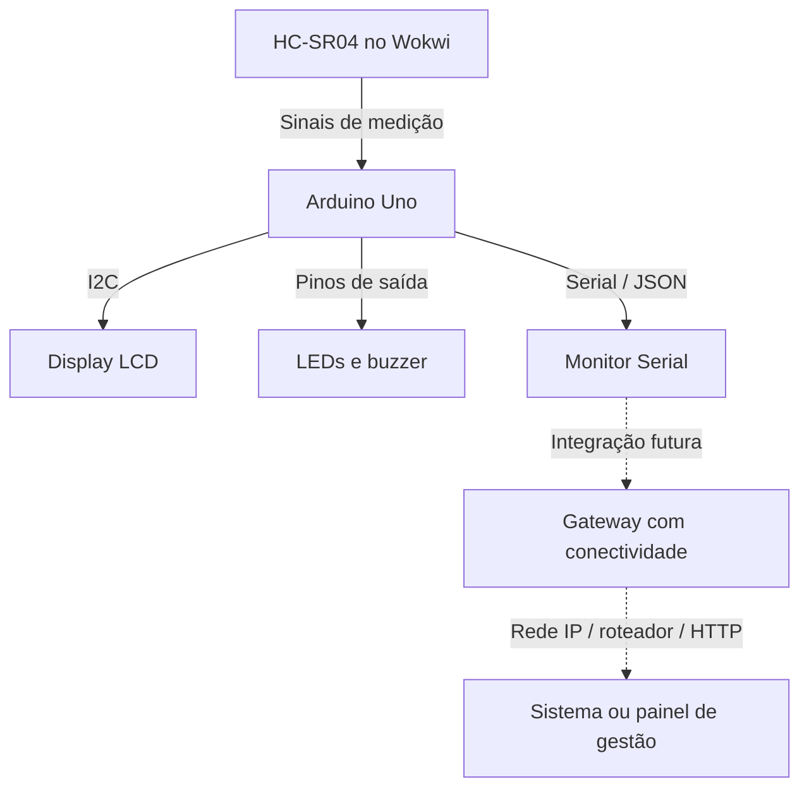

# Binova — Monitoramento Inteligente de Lixeiras

**FIAP | Global Solution 2026/2 — CitizenTech**  
**Disciplina:** Disruptive Architectures: IoT, IoB & Generative IA

**[Abrir o protótipo Binova no Wokwi](https://wokwi.com/projects/480777708369869825)**

## 1. Sobre o projeto

O **Binova** é um protótipo de monitoramento do nível de preenchimento de lixeiras. A proposta busca facilitar a identificação de recipientes próximos da capacidade máxima, contribuindo para o planejamento da coleta de resíduos e para a manutenção dos espaços utilizados pela população.

O protótipo foi desenvolvido com **Arduino Uno** e **sensor ultrassônico HC-SR04** no simulador Wokwi. O Arduino interpreta a distância medida, calcula o percentual de preenchimento e apresenta a situação por meio de um display LCD, LEDs e avisos sonoros. As leituras também são impressas em formato JSON no Monitor Serial.

## 2. Componentes e tecnologias

| Componente | Função |
| --- | --- |
| Arduino Uno | Processa as leituras e controla os indicadores. |
| Sensor HC-SR04 | Mede a distância até a superfície dos resíduos simulados. |
| Display LCD 16x2 com I2C | Exibe o percentual e a situação da lixeira. |
| LED verde, amarelo e vermelho | Representam os níveis de disponibilidade, atenção e alerta. |
| Buzzer | Emite avisos ao entrar nas faixas críticas. |
| Protoboard e resistores de 220 Ω | Organizam as ligações dos LEDs e limitam a corrente. |
| Wokwi | Simulação do circuito e execução do código Arduino. |
| C++ / Arduino | Linguagem utilizada na programação do protótipo. |

A biblioteca do display, **LiquidCrystal I2C**, consta no arquivo `GlobalSolution_Sensor_Lixo/libraries.txt`.

## 3. Como executar

1. Acesse o **[projeto no Wokwi](https://wokwi.com/projects/480777708369869825)**.
2. Clique em **Start Simulation** para iniciar o Arduino.
3. Observe o LCD, os LEDs e o Monitor Serial.
4. Para testar o HC-SR04, abra `sketch.ino`, defina `NIVEL_MANUAL = -1`, reinicie a simulação e altere a distância do sensor virtual.
5. Para testar um percentual específico, informe um número inteiro de **1 a 100** em `NIVEL_MANUAL` e reinicie a simulação.

Exemplos de configuração no código:

```cpp
const int NIVEL_MANUAL = -1; // Leitura pelo HC-SR04
// const int NIVEL_MANUAL = 75; // Exemplo de teste manual: 75%
```

> **Importante:** no modo manual, o percentual informado é um valor de teste e **não** uma leitura do HC-SR04. Para medir a distância com o sensor virtual, é necessário utilizar `-1`.

Para reproduzir localmente, os arquivos do projeto Arduino estão em [`GlobalSolution_Sensor_Lixo/`](GlobalSolution_Sensor_Lixo/): `diagram.json`, `sketch.ino` e `libraries.txt`.

## 4. Funcionamento e critérios

Na configuração de referência, a distância de **25 cm** representa uma lixeira vazia (0%) e a de **5 cm** representa uma lixeira cheia (100%). Os valores intermediários são convertidos proporcionalmente para uma porcentagem entre 0 e 100. A leitura do sensor utiliza a **mediana de cinco medições válidas** para reduzir variações, e o sistema é atualizado a cada **2 segundos**.

| Preenchimento | Situação no LCD | Indicador |
| --- | --- | --- |
| 0% a 49% | `DISPONIVEL` | LED verde |
| 50% a 74% | `ATENCAO` | LED amarelo |
| 75% a 94% | `PROX. DO LIMITE` | LED vermelho; aviso sonoro ao entrar na faixa |
| 95% a 100% | `CHEIO` | LED vermelho; aviso sonoro ao entrar na faixa |

Caso o sensor não apresente uma medição válida, o LCD informa a falha e os LEDs são desligados.

### Monitor Serial

O Arduino envia mensagens JSON a **9600 baud**. Os campos indicam a origem da leitura, permitindo distinguir os testes manuais das medições do sensor:

```json
{"distanciaCm":15.0,"nivelPercentual":50,"valida":true,"modo":"sensor"}
```

```json
{"nivelPercentual":95,"valida":true,"modo":"manual"}
```

Essas mensagens são **exemplos do formato esperado**, não evidências de transmissão para um servidor externo.

## 5. Arquitetura e comunicação

O circuito implementado realiza a leitura do sensor, o processamento no Arduino e a apresentação local dos dados. A saída em JSON ocorre pelo **Monitor Serial do Wokwi**.

A comunicação por rede até um sistema de gestão é uma **proposta de evolução**: seria necessário um dispositivo com conectividade, como um gateway conectado ao Arduino, para encaminhar os dados por uma rede IP.



**Linhas contínuas:** funcionalidades implementadas no simulador. **Linhas tracejadas:** comunicação em rede proposta, ainda não implementada.

A descrição complementar encontra-se em [Proposta de comunicação](Evidencias/07_Arquitetura_Proposta/PROPOSTA_COMUNICACAO.md).

## 6. Testes e evidências

Os registros visuais estão organizados em [`Evidencias/`](Evidencias/). Foram utilizados dois tipos de teste:

- **Modo sensor:** comprovação da aquisição de dados pelo HC-SR04 virtual.
- **Modo manual:** verificação isolada das mensagens, dos LEDs e dos limiares de alerta com percentuais definidos no código.

| Caso de teste | Modo | Resultado esperado | Evidência |
| --- | --- | --- | --- |
| 50% | Sensor HC-SR04 | `ATENCAO`, LED amarelo | [Captura](Evidencias/02_Leitura_HC_SR04/01_Sensor_50porcento_Atencao.png) |
| 25% | Manual | `DISPONIVEL`, LED verde | [Captura](Evidencias/03_Testes_Manuais/01_Manual_25porcento_Disponivel.png) |
| 53% | Manual | `ATENCAO`, LED amarelo | [Captura](Evidencias/03_Testes_Manuais/02_Manual_53porcento_Atencao.png) |
| 75% | Manual | `PROX. DO LIMITE`, LED vermelho | [Captura](Evidencias/03_Testes_Manuais/03_Manual_75porcento_ProximoLimite.png) |
| 83% | Manual | `PROX. DO LIMITE`, LED vermelho | [Captura](Evidencias/03_Testes_Manuais/04_Manual_83porcento_ProximoLimite.png) |
| 95% | Manual | `CHEIO`, LED vermelho | [Captura](Evidencias/03_Testes_Manuais/05_Manual_95porcento_Cheio.png) |
| 100% | Manual | `CHEIO`, LED vermelho | [Captura](Evidencias/03_Testes_Manuais/06_Manual_100porcento_Cheio.png) |
| 95% | Serial / manual | JSON indicando `modo: manual` | [Captura](Evidencias/04_Monitor_Serial/01_JSON_95porcento_Modo_Manual.png) |

Também estão disponíveis a [visão geral do circuito](Evidencias/01_Circuito/01_Circuito_Visao_Geral_Parado.png) e as [imagens dos componentes](Evidencias/05_Componentes/).

**Demonstração em vídeo:** será adicionada à pasta `Evidencias/06_Video/` após a gravação. A confirmação do alerta sonoro deve ser feita durante a execução do simulador ou no vídeo, pois uma imagem estática não registra o som.

## 7. Limitações e melhorias futuras

- A montagem foi **simulada no Wokwi**; não representa ensaios com uma lixeira física e resíduos reais.
- Os limites de distância (25 cm e 5 cm) são valores de referência do protótipo e dependem das dimensões da lixeira utilizada em uma implantação real.
- O modo manual serve para testar os indicadores; não comprova aquisição de dados do sensor.
- O Arduino Uno da simulação não realiza transmissão Wi-Fi ou HTTP. A comunicação por rede é apresentada como **proposta de arquitetura**, não como integração concluída.
- A operação em campo exigiria proteção e posicionamento do sensor, alimentação elétrica e validação em condições ambientais reais.

## 8. Estrutura do repositório

```text
GlobalSolution_2026_IoT/
├── README.md
├── GlobalSolution_Sensor_Lixo/
│   ├── diagram.json
│   ├── sketch.ino
│   ├── libraries.txt
│   └── wokwi-project.txt
└── Evidencias/
    ├── 01_Circuito/
    ├── 02_Leitura_HC_SR04/
    ├── 03_Testes_Manuais/
    ├── 04_Monitor_Serial/
    ├── 05_Componentes/
    ├── 06_Video/
    └── 07_Arquitetura_Proposta/
```

## 9. Integrantes

| Integrante | RM |
| --- | --- |
| Gustavo de Jesus | 567926 |
| Gustavo Siciliano | 568419 |
| Samuel Keniti | 567614 |
| Manuel Pedro | 567458 |
| Vinicius Morrone | 566884 |

**Repositório:** https://github.com/GustavoSiciliano/GlobalSolution_2026_IoT  
**Simulação Wokwi:** https://wokwi.com/projects/480777708369869825

---

**Observação para a entrega FIAP:** o envio no Portal do Aluno é realizado por arquivo `.txt` com nomes completos, RMs e link do repositório, conforme as instruções da disciplina. Os arquivos de código, evidências e documentação ficam no GitHub.
