# Binova | Monitoramento Inteligente de Lixeiras

**FIAP | Global Solution 2026/2 | CitizenTech**

**Curso:** Análise e Desenvolvimento de Sistemas  
**Disciplina:** Disruptive Architectures: IoT, IoB & Generative IA  
**Turma:** 2TDSPS

**[Simulação no Wokwi](https://wokwi.com/projects/480777708369869825) | [Vídeo de demonstração](https://youtu.be/vmdYMs3CHB0) | [Código Arduino](GlobalSolution_Sensor_Lixo/sketch.ino)**

## 1. Apresentação do projeto

O **Binova** é um projeto de monitoramento inteligente de lixeiras, desenvolvido para a Global Solution 2026/2 da FIAP, com o tema CitizenTech. A ideia surgiu da necessidade de encontrar uma maneira simples de acompanhar o preenchimento dos recipientes de resíduos e identificar quando um ponto de coleta precisa de atenção.

Em muitos espaços, a verificação das lixeiras depende de inspeções presenciais ou de avisos feitos quando elas já estão cheias. Pensando nisso, desenvolvemos um protótipo que utiliza um sensor para estimar o nível de preenchimento e informar a situação da lixeira por meio de indicadores visuais e sonoros.

O circuito foi desenvolvido com **Arduino Uno, sensor ultrassônico HC-SR04, display LCD I2C, LEDs e buzzer**, utilizando a plataforma Wokwi para realizar as simulações e os testes.

Além do monitoramento local, o projeto apresenta uma proposta de comunicação em rede utilizando **ESP32, Wi-Fi e MQTT**. Essa arquitetura permitiria transmitir as informações para um sistema de gestão, facilitando o acompanhamento de diferentes pontos de coleta.

### 1.1 Objetivos

O principal objetivo do Binova é demonstrar como sensores e sistemas embarcados podem auxiliar no monitoramento de resíduos urbanos.

Para isso, o projeto busca:

- Estimar o percentual de preenchimento de uma lixeira por meio do sensor HC-SR04.
- Informar a situação do recipiente utilizando um display LCD e LEDs.
- Emitir alertas sonoros quando o preenchimento atingir níveis críticos.
- Validar as medições e reduzir oscilações nas leituras do sensor.
- Organizar as informações em formato JSON por meio da comunicação serial.
- Apresentar uma arquitetura de comunicação em rede utilizando ESP32 e MQTT.
- Documentar os componentes, testes e resultados obtidos na simulação.

### 1.2 Relação com os Objetivos de Desenvolvimento Sustentável (ODS)

O Binova está relacionado ao **ODS 11, Cidades e Comunidades Sustentáveis**, especialmente à melhoria da gestão de resíduos em espaços urbanos.

A proposta busca facilitar a identificação de lixeiras próximas da capacidade máxima, oferecendo informações que podem ajudar as equipes responsáveis a organizar a coleta e priorizar os locais que precisam de atendimento. Dessa forma, o projeto apresenta uma possibilidade de utilizar a tecnologia para contribuir com espaços públicos mais organizados e sustentáveis.

Essa contribuição representa o objetivo da solução, considerando que seus impactos em um ambiente real ainda dependeriam de testes e acompanhamento.

## 2. Integrantes

| Integrante | RM |
|---|---|
| Gustavo de Jesus | 567926 |
| Gustavo Siciliano | 568419 |
| Samuel Keniti | 567614 |
| Manuel Pedro | 567458 |
| Vinicius Morrone | 566884 |

## 3. Tecnologias e componentes utilizados

Para a construção do protótipo, selecionamos componentes que permitem realizar as medições, processar as informações e apresentar o resultado diretamente no circuito.

| Componente | Função |
|---|---|
| Arduino Uno | Controla o circuito, processa as leituras e executa as regras de preenchimento. |
| HC-SR04 | Mede a distância entre o sensor e a superfície dos resíduos. |
| LCD 16x2 I2C | Apresenta o percentual de preenchimento e a situação da lixeira. |
| LED verde | Indica que a lixeira está disponível. |
| LED amarelo | Indica que a lixeira exige atenção. |
| LED vermelho | Indica que a lixeira está próxima do limite ou cheia. |
| Buzzer | Emite alertas sonoros quando o preenchimento atinge níveis críticos. |
| Protoboard | Organiza as conexões entre os componentes. |
| Resistores de 220 Ω | Limitam a corrente elétrica dos LEDs. |
| Wokwi | Permite simular o circuito e verificar seu comportamento. |
| Arduino C/C++ | Linguagem utilizada na programação do microcontrolador. |

### 3.1 Mapeamento dos pinos

As conexões foram distribuídas da seguinte maneira:

| Componente | Pino do Arduino |
|---|---|
| HC-SR04 TRIG | D8 |
| HC-SR04 ECHO | D2 |
| LED verde | A0 |
| LED amarelo | A1 |
| LED vermelho | A2 |
| Buzzer | A3 |
| LCD SDA | A4 |
| LCD SCL | A5 |

O display utiliza o endereço I2C `0x27`. As conexões de alimentação e o posicionamento dos componentes estão disponíveis no arquivo [diagram.json](GlobalSolution_Sensor_Lixo/diagram.json).

## 4. Funcionamento do protótipo

O funcionamento do Binova começa com a medição realizada pelo sensor HC-SR04.

O Arduino recebe essa informação, calcula o percentual estimado de preenchimento e identifica a situação da lixeira. Em seguida, atualiza os LEDs, o display LCD e os alertas sonoros.

Os dados também são apresentados no Monitor Serial, permitindo acompanhar as leituras durante a simulação.

### 4.1 Leitura do sensor HC-SR04

O HC-SR04 utiliza ondas ultrassônicas para medir a distância até um objeto.

O Arduino envia um pulso pelo pino `TRIG` e recebe o sinal de retorno pelo pino `ECHO`. A partir do tempo de resposta, o programa calcula a distância.

Na simulação do Binova, consideramos que o sensor está posicionado na parte superior da lixeira. Conforme os resíduos se aproximam dele, a distância diminui e o percentual de preenchimento aumenta.

Para melhorar a estabilidade das informações, o código realiza até cinco tentativas de medição. Quando pelo menos três leituras são válidas, utiliza a mediana das distâncias obtidas.

Também são descartadas medições fora do intervalo operacional de 2 a 400 centímetros.

As informações são atualizadas aproximadamente a cada dois segundos.

### 4.2 Cálculo do percentual

Para calcular o preenchimento, definimos duas referências para a simulação:

| Condição | Distância | Preenchimento |
|---|---|---|
| Lixeira vazia | 25 cm | 0% |
| Lixeira cheia | 5 cm | 100% |

O cálculo utilizado é:

```text
Preenchimento (%) = 100 × (25 - distância) / 20
```

O resultado é arredondado para um número inteiro e limitado ao intervalo de 0% a 100%.

Alguns exemplos:

| Distância | Preenchimento |
|---|---|
| 25 cm | 0% |
| 20 cm | 25% |
| 15 cm | 50% |
| 10 cm | 75% |
| 6 cm | 95% |
| 5 cm | 100% |

Esses valores foram definidos para o protótipo acadêmico. Em uma aplicação física, seria necessário ajustar as referências conforme o tamanho e as características de cada lixeira.

### 4.3 Estados de preenchimento

O programa classifica o preenchimento em quatro situações:

| Preenchimento | Situação | LED | Buzzer |
|---|---|---|---|
| 0% a 49% | Disponível | Verde | Desligado |
| 50% a 74% | Atenção | Amarelo | Desligado |
| 75% a 94% | Próximo do limite | Vermelho | Alerta ao entrar na faixa |
| 95% a 100% | Cheio | Vermelho | Alerta ao entrar na faixa |

O display LCD apresenta o percentual e a situação correspondente.

O buzzer emite um aviso quando o sistema entra em uma faixa crítica. Dessa maneira, o alerta não precisa ser repetido continuamente durante cada atualização.

Quando não existem leituras suficientes para calcular um resultado confiável, o Arduino informa a ausência de dados e mantém os LEDs apagados.

## 5. Modos de funcionamento e testes

Para facilitar a validação do circuito, desenvolvemos dois modos de funcionamento.

### 5.1 Modo sensor

É o modo principal do Binova. Nesse caso, o Arduino utiliza as informações fornecidas pelo HC-SR04 para calcular o preenchimento.

No arquivo `sketch.ino`, utilizamos:

```cpp
const int NIVEL_MANUAL = -1;
```

Durante a simulação, podemos alterar a distância do sensor e acompanhar as mudanças nos indicadores.

### 5.2 Modo manual

O modo manual foi criado para testar valores específicos de preenchimento.

Ele permite verificar as regras de funcionamento sem depender de uma distância exata configurada no sensor.

Por exemplo:

```cpp
const int NIVEL_MANUAL = 83;
```

Nesse caso, o sistema considera o preenchimento de 83% e apresenta a situação de proximidade do limite.

O código permite definir percentuais manuais de 1 a 100.

Para voltar à leitura do HC-SR04, basta configurar novamente:

```cpp
const int NIVEL_MANUAL = -1;
```

Os testes manuais foram utilizados principalmente para verificar o comportamento dos LEDs, do LCD e dos alertas nos diferentes níveis de preenchimento.

## 6. Comunicação serial

Além de controlar os indicadores, o Arduino disponibiliza as informações por meio da comunicação serial, configurada em **9600 baud**.

Os dados são apresentados em formato JSON, o que facilita sua leitura e organização.

Uma mensagem gerada no modo sensor possui a seguinte estrutura:

```json
{
  "distanciaCm": 15.0,
  "nivelPercentual": 50,
  "valida": true,
  "modo": "sensor"
}
```

No modo manual, o Arduino informa o percentual definido para o teste:

```json
{
  "nivelPercentual": 95,
  "valida": true,
  "modo": "manual"
}
```

Caso o sensor não consiga fornecer uma leitura válida, a mensagem informa essa condição:

```json
{
  "valida": false,
  "modo": "sensor"
}
```

Essas informações permitem verificar se o Arduino está processando corretamente os dados e servem como referência para a proposta de comunicação em rede.

A comunicação serial também facilita a identificação de erros durante os testes, pois podemos acompanhar diretamente os valores produzidos pelo código.

## 7. Arquitetura atual do Binova

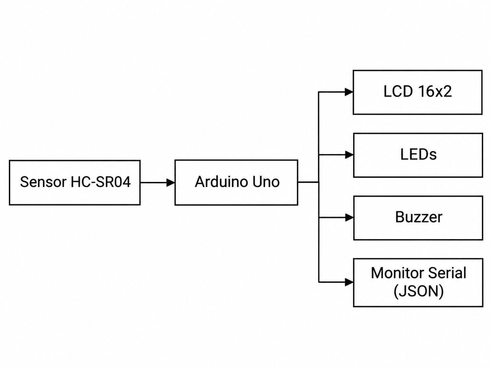

A arquitetura atual representa o funcionamento do protótipo desenvolvido no Wokwi.

O sensor HC-SR04 realiza a medição da distância e envia o resultado para o Arduino Uno.

O Arduino processa as informações, calcula o percentual de preenchimento e identifica a situação da lixeira.

A partir desse resultado, os componentes desempenham suas funções:

- **LCD:** apresenta o preenchimento e a situação identificada.
- **LEDs:** indicam visualmente o estado da lixeira.
- **Buzzer:** emite alertas quando o preenchimento atinge uma faixa crítica.
- **Monitor Serial:** apresenta as informações em JSON para acompanhamento e validação dos testes.

A comunicação entre os componentes utiliza sinais digitais, protocolo I2C para o LCD e comunicação serial UART para a saída de dados.

Essa arquitetura permite que o protótipo realize as medições e apresente os resultados localmente.

## 8. Proposta de evolução da arquitetura

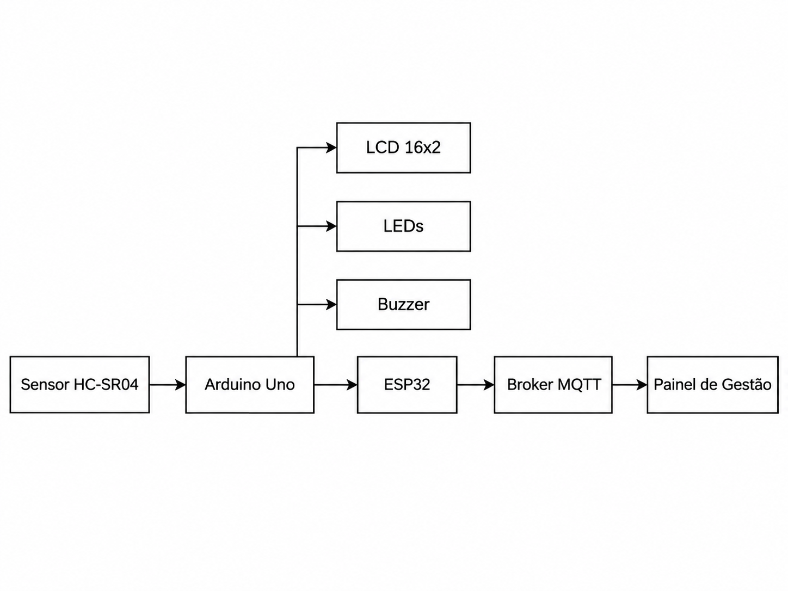

Pensando na utilização do Binova em diferentes pontos de coleta, elaboramos uma proposta para ampliar a comunicação do sistema.

A ideia é manter o **Arduino Uno como responsável pela leitura e pelo processamento dos dados** e acrescentar um **ESP32**, que funcionaria como módulo de conectividade.

O Arduino continuaria controlando o LCD, os LEDs e o buzzer. Já o ESP32 receberia as informações e utilizaria sua conexão Wi-Fi para transmiti-las por meio do protocolo MQTT.

### 8.1 Fluxo de comunicação

O fluxo proposto funcionaria da seguinte maneira:

1. O sensor HC-SR04 realiza a medição da distância.
2. O Arduino Uno calcula o percentual de preenchimento e identifica a situação da lixeira.
3. O Arduino organiza as informações em JSON.
4. Os dados são encaminhados ao ESP32 por comunicação serial UART.
5. O ESP32 conecta-se à rede Wi-Fi e publica as informações em um broker MQTT.
6. O broker distribui as mensagens aos sistemas inscritos no tópico correspondente.
7. Um painel de gestão utiliza essas informações para acompanhar os pontos de coleta.

Essa organização separa o processamento local da comunicação em rede.

Mesmo com a proposta de monitoramento remoto, os indicadores locais continuariam sendo importantes para informar a situação diretamente no ponto de coleta.

### 8.2 Protocolo MQTT

O MQTT é um protocolo de comunicação utilizado em aplicações com dispositivos conectados.

Seu funcionamento é baseado no modelo de publicação e assinatura.

Nesse modelo, os dispositivos publicam mensagens em tópicos específicos, enquanto os sistemas interessados recebem as informações ao se inscreverem nesses tópicos.

Para o Binova, a proposta considera três elementos principais:

| Elemento | Responsabilidade |
|---|---|
| ESP32 | Publicar as leituras recebidas do Arduino. |
| Broker MQTT | Receber as mensagens e encaminhá-las aos assinantes. |
| Painel de gestão | Receber e apresentar as informações de preenchimento. |

O MQTT foi escolhido para a proposta porque permite trabalhar com mensagens pequenas e periódicas, características comuns em aplicações de monitoramento IoT.

### 8.3 Organização das mensagens

Cada lixeira poderia possuir um identificador próprio, permitindo separar as informações dos diferentes pontos de coleta.

Um exemplo de tópico seria:

```text
binova/lixeiras/lixeira01/leituras
```

A mensagem publicada poderia seguir o formato:

```json
{
  "idPonto": "lixeira01",
  "distanciaCm": 10.0,
  "nivelPercentual": 75,
  "situacao": "PROXIMO_DO_LIMITE",
  "modo": "sensor"
}
```

Com essa estrutura, o sistema conseguiria identificar a origem de cada leitura e o estado do recipiente.

O painel de gestão poderia utilizar as informações para apresentar os níveis de preenchimento, manter um histórico das medições e destacar os locais que necessitam de atendimento.

### 8.4 Cuidados com a comunicação

Para aplicar essa arquitetura em um ambiente físico, alguns aspectos precisariam ser considerados.

A comunicação entre Arduino Uno e ESP32 exigiria atenção aos níveis de tensão, pois o Arduino Uno utiliza sinais de 5 V e o ESP32 trabalha com lógica de 3,3 V.

Também seria necessário tratar possíveis interrupções da conexão Wi-Fi, validar as mensagens recebidas e configurar mecanismos de segurança para o acesso ao broker MQTT.

Outro ponto importante seria associar cada dispositivo ao ponto de coleta correto, evitando que informações de lixeiras diferentes sejam misturadas.

Esses cuidados ajudariam a tornar a solução mais confiável para um cenário com vários recipientes monitorados.

## 9. Como executar o protótipo

O Binova pode ser executado diretamente no navegador pela plataforma Wokwi.

**Simulação:** https://wokwi.com/projects/480777708369869825

Para realizar os testes:

1. Abra o projeto no Wokwi.
2. Clique em **Start Simulation**.
3. Observe o display LCD e os LEDs.
4. Selecione o sensor HC-SR04.
5. Altere a distância para observar as mudanças no percentual de preenchimento.
6. Abra o Monitor Serial para acompanhar as mensagens JSON.
7. Para realizar testes com valores específicos, altere a constante `NIVEL_MANUAL` no código e reinicie a simulação.

O protótipo está organizado nos seguintes arquivos:

| Arquivo | Descrição |
|---|---|
| `sketch.ino` | Código responsável pelas leituras, cálculos e alertas. |
| `diagram.json` | Estrutura do circuito e conexões dos componentes. |
| `libraries.txt` | Biblioteca utilizada para controlar o LCD I2C. |
| `wokwi-project.txt` | Referência ao projeto publicado no Wokwi. |

Os arquivos estão disponíveis na pasta [GlobalSolution_Sensor_Lixo](GlobalSolution_Sensor_Lixo/).

## 10. Testes e evidências

Durante o desenvolvimento, realizamos simulações para acompanhar o comportamento do sensor e verificar as situações de preenchimento.

As evidências foram organizadas por tipo de teste para facilitar a visualização dos resultados.

### 10.1 Circuito completo

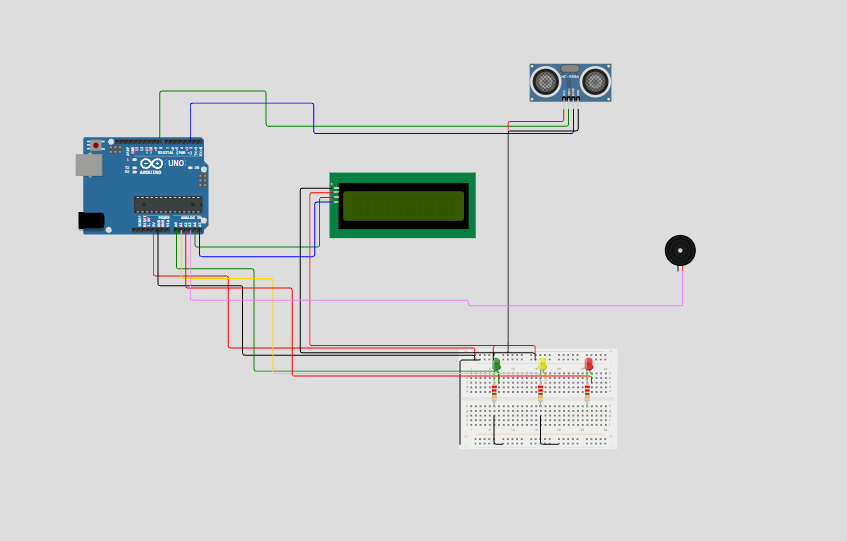

A imagem apresenta a montagem geral do protótipo, com Arduino Uno, HC-SR04, LCD, LEDs, resistores, protoboard e buzzer.

### 10.2 Leitura pelo HC-SR04

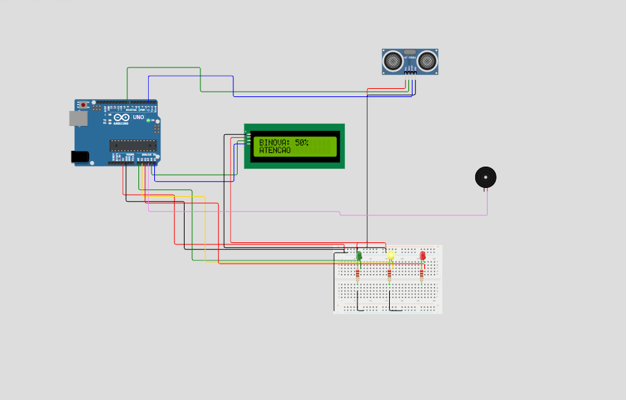

Teste realizado com o sensor virtual, apresentando aproximadamente 50% de preenchimento e o estado de atenção.

Essa etapa permite observar o cálculo do percentual a partir da distância medida.

### 10.3 Testes manuais

Para verificar as faixas de preenchimento, utilizamos valores definidos diretamente no código.

**Disponível e atenção**

| 25% | 53% |
|---|---|
| 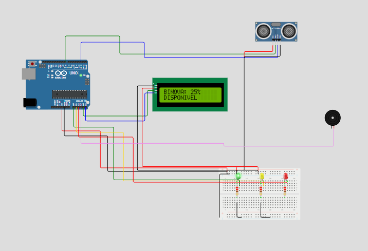 | 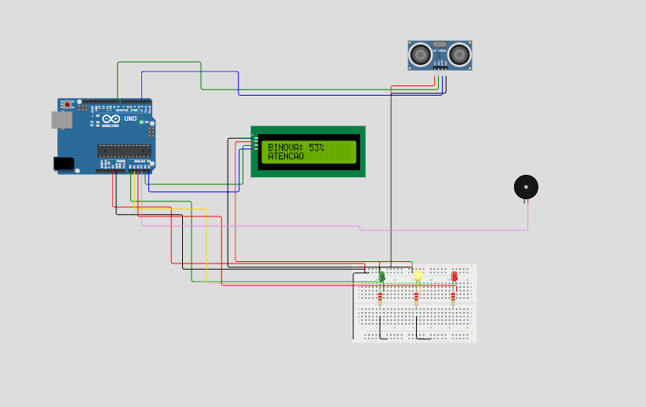 |

Com 25%, o sistema apresenta a situação disponível. Ao atingir 53%, passa para atenção.

**Próximo do limite**

| 75% | 83% |
|---|---|
| 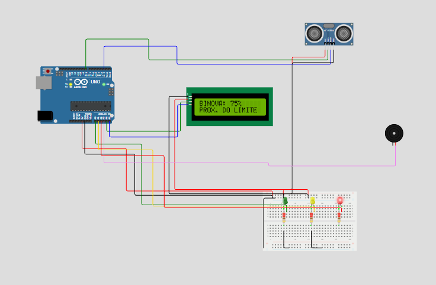 | 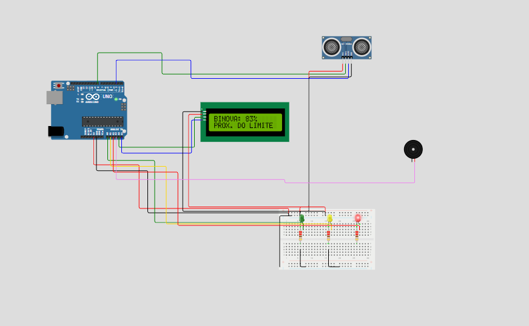 |

Nesses testes, verificamos a sinalização vermelha e a classificação de proximidade do limite.

**Lixeira cheia**

| 95% | 100% |
|---|---|
| 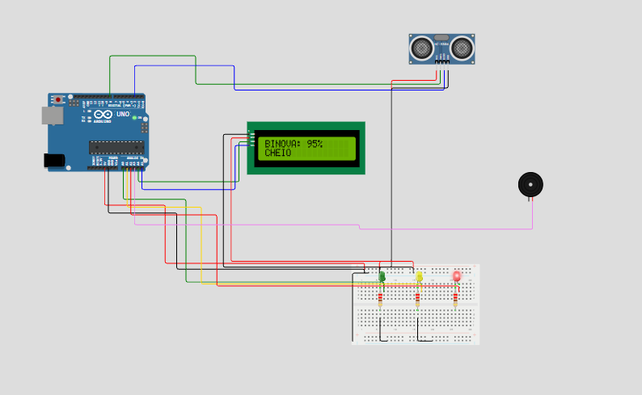 | 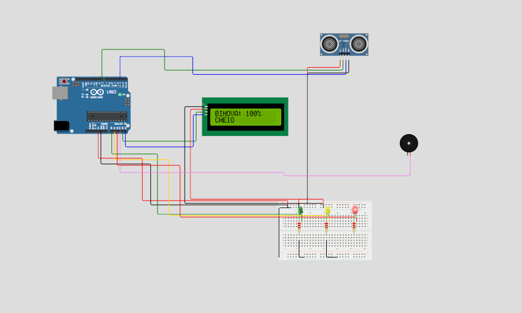 |

Os testes verificam a classificação de lixeira cheia e o comportamento dos indicadores nos níveis máximos.

### 10.4 Comunicação serial

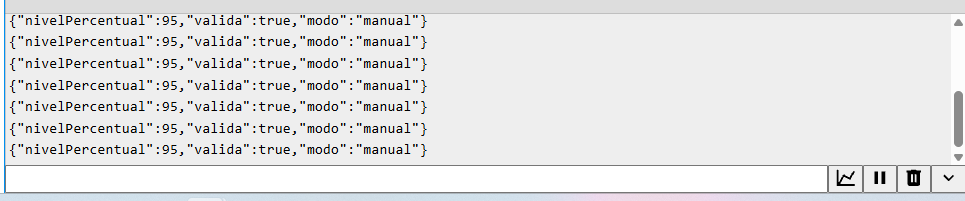

A captura apresenta uma mensagem JSON gerada pelo Arduino durante um teste manual de 95% de preenchimento.

O registro permite conferir os campos enviados e verificar a organização das informações produzidas pelo protótipo.

### 10.5 Componentes utilizados

As imagens abaixo mostram os principais componentes presentes na montagem.

| Arduino Uno | Sensor HC-SR04 | LCD I2C |
|---|---|---|
| 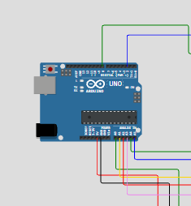 | 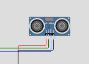 | 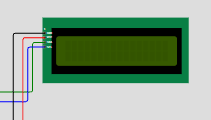 |

| Protoboard, LEDs e resistores | Buzzer |
|---|---|
| 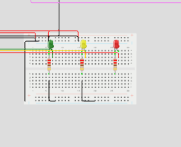 | 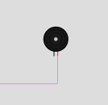 |

### 10.6 Resumo dos testes

| Teste | Entrada | Situação esperada |
|---|---|---|
| HC-SR04 | 15 cm | 50%, atenção |
| Manual | 25% | Disponível |
| Manual | 53% | Atenção |
| Manual | 75% | Próximo do limite |
| Manual | 83% | Próximo do limite |
| Manual | 95% | Cheio |
| Manual | 100% | Cheio |
| Monitor Serial | 95% manual | Mensagem JSON |

Os testes permitem verificar as diferentes faixas de preenchimento e o comportamento dos indicadores conforme as regras definidas no código.

## 11. Vídeo de demonstração

**[Assistir à demonstração do Binova no YouTube](https://youtu.be/vmdYMs3CHB0)**

[](https://youtu.be/vmdYMs3CHB0)

O vídeo apresenta o protótipo desenvolvido no Wokwi e demonstra seu funcionamento, incluindo as leituras do sensor, a identificação dos níveis de preenchimento e o comportamento dos componentes.

A gravação complementa as evidências disponíveis no repositório, permitindo acompanhar o funcionamento do circuito de maneira contínua.

**Link:** https://youtu.be/vmdYMs3CHB0

## 12. Estrutura do repositório

```text
GlobalSolution_2026_IoT/
|
|-- README.md
|
|-- Diagram/
|   |-- Arquitetura_Atual.png
|   |-- Arquitetura_Futuro.png
|
|-- GlobalSolution_Sensor_Lixo/
|   |-- sketch.ino
|   |-- diagram.json
|   |-- libraries.txt
|   |-- wokwi-project.txt
|
|-- Evidencias/
    |-- 01_Circuito/
    |-- 02_Leitura_HC_SR04/
    |-- 03_Testes_Manuais/
    |-- 04_Monitor_Serial/
    |-- 05_Componentes/
    |-- 06_Video/
    |-- 07_Arquitetura_Proposta/
```

A pasta `GlobalSolution_Sensor_Lixo` contém os arquivos do protótipo.

Na pasta `Diagram`, estão disponíveis os diagramas da arquitetura atual e da proposta de evolução.

A pasta `Evidencias` reúne os registros das simulações, testes e componentes utilizados.

## 13. Considerações finais

O desenvolvimento do Binova permitiu aplicar conceitos de sistemas embarcados, sensores e comunicação de dados em uma situação relacionada ao cotidiano das cidades.

Com o Arduino Uno e o HC-SR04, conseguimos criar um protótipo capaz de estimar o preenchimento de uma lixeira e apresentar os resultados por meio de indicadores locais.

Os testes realizados no Wokwi ajudaram a verificar as regras de funcionamento, enquanto a comunicação serial permitiu acompanhar os dados produzidos pelo sistema.

A arquitetura proposta com ESP32 e MQTT apresenta um caminho para ampliar o monitoramento e permitir o acompanhamento remoto de vários pontos de coleta.

O projeto reúne o circuito, o código, os diagramas, as evidências e o vídeo de demonstração, documentando as decisões adotadas durante o desenvolvimento.